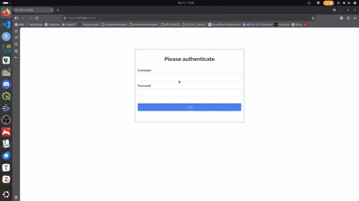
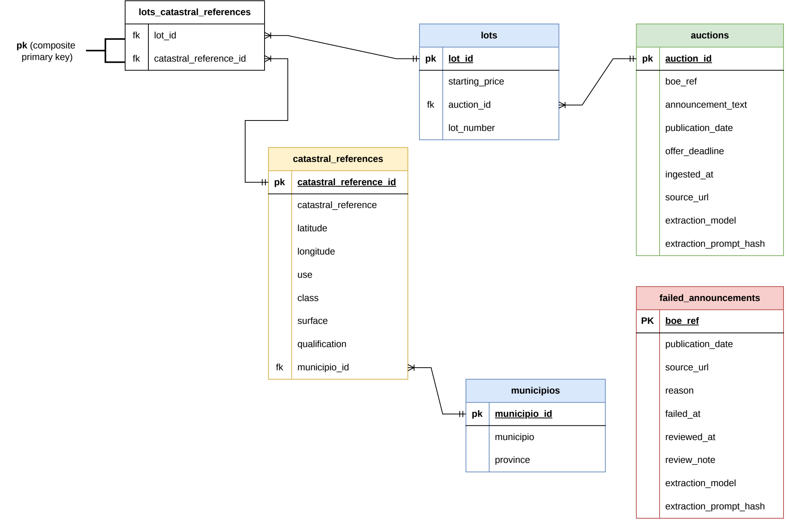
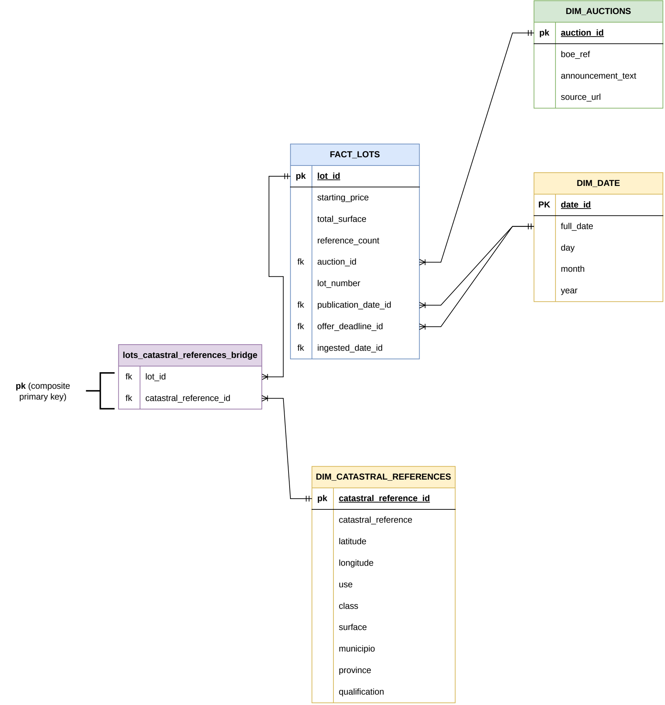

# Subastas Analytics: from BOE auctions to a decision-making dashboard

[](https://github.com/MiguelDonado/subastas_analytics/actions/workflows/tests.yml)

A personal project to keep learning data engineering, especially OLAP data
modelling, build my first GenAI application, and practice the skill of building
useful things.

The problem here was my own. A few years ago I bought some rustic properties at
the public auctions of the Spanish State, and evaluating each one took me a lot
of time. Not only because I had to jump by hand between the BOE, the Catastro,
map viewers and other websites, but also because the process wasn't organized:
I often had to check the same land several times, because I didn't remember
some of its characteristics.

Why it was a good fit for this kind of project:

- **A clear use for GenAI:** the auctions are public, but they come in raw form:
  long documents with many pages of legal text, when only a few details matter,
  like the lots, their prices and their catastral references. Claude reads each
  announcement and pulls out just those details.
- **A clear data engineering pipeline:** a weekly Airflow DAG collects the
  announcements, uses Claude (API) to pull out the useful information, adds
  Catastro data (API) and loads everything into PostgreSQL.
- **A clear final use:** a web app where I explore the lots on a map and in a
  table, and decide which ones are worth investing in. It's useful for me and
  two close contacts who also want to invest in these properties.

**Live app:** <https://01a1e61c-7dc8-69e3-b535-b360f28ed430.share.connect.posit.cloud/>
(the first visit after a while takes a few seconds, while the app and the
database wake up)

Each of us three has a private user with our own notes. Anyone can try the app
with the public test user: username `test`, password `test`. The downside is
that its notes are shared with everyone who uses it.

---

## 🎥 Video Tutorials

> [!IMPORTANT]
> **Watch these videos before using the application.**
>
> 1. ▶️ **[Project walkthrough](TODO)**: the project and how the code works
> 2. ▶️ **[How to use the dashboard](https://youtu.be/CzUdDmlI93k)**: filters, map, table and notes
> 3. ▶️ **[Local setup](TODO)**: how to run the project on your machine

---

## Table of Contents

- [Subastas Analytics: from BOE auctions to a decision-making dashboard](#subastas-analytics-from-boe-auctions-to-a-decision-making-dashboard)
  - [🎥 Video Tutorials](#-video-tutorials)
  - [Table of Contents](#table-of-contents)
  - [Demo](#demo)
  - [Background](#background)
  - [Objectives](#objectives)
  - [Tech stack](#tech-stack)
  - [Workflow](#workflow)
    - [1. Data engineering](#1-data-engineering)
    - [2. Web application](#2-web-application)
    - [3. Analytics: how I use it to decide](#3-analytics-how-i-use-it-to-decide)
    - [Database: OLAP and OLTP](#database-olap-and-oltp)
  - [Deployment](#deployment)
  - [CI/CD](#cicd)
  - [Getting Started](#getting-started)
    - [Prerequisites](#prerequisites)
    - [Setup](#setup)
  - [Future improvements](#future-improvements)
  - [License](#license)

---

## Demo

A short walkthrough:



---

## Background

The Spanish State sells through public auctions the properties it owns but
doesn't need, either for public use or for a public service, and that aren't
worth managing itself. Many of them are rustic land. The State can own them for
different reasons: expropriations, inheritances, or land left over after a land
consolidation (concentración parcelaria). Each auction is published in two places:

- **Hacienda's website**, [Listado de subastas y concursos](https://www.hacienda.gob.es/es-ES/Areas%20Tematicas/Patrimonio%20del%20Estado/Gestion%20Patrimonial%20del%20Estado/Paginas/Subastas/ListadoSubastasConcursos.aspx),
  publishes the pliego de condiciones of each auction: a PDF with the complete,
  detailed information. Example: [pliego of an auction in Soria](assets/example_pliego_soria.pdf).
- **The [BOE](https://www.boe.es)** (Boletín Oficial del Estado) publishes a
  daily summary, served by the [BOE Open Data API](https://www.boe.es/datosabiertos/),
  that includes each auction. For each one there is an announcement, available
  as XML or TXT, rather than the PDF pliego. It has a bit less information than the
  pliego, but enough for this app, so the pipeline reads these announcements.
  Example: [announcement of the same auction](https://www.boe.es/diario_boe/txt.php?id=BOE-B-2026-34259).

**Why do I care about these auctions?**

I like nature and see rustic land as a good investment. I'd also like to do
projects on it in the near future, like planting trees. So once I start
working again, I'd like to buy more if I see a good opportunity.

**Why build an application instead of doing it by hand?**

By hand, every announcement meant reading the text, finding the catastral
references and looking each parcel up in the Catastro and other map viewers.
This application does that work for me and keeps everything in one place, so I
can compare the lots and decide faster.

---

## Objectives

1. **Practice building useful things.** With AI, only executing technical tasks
   has less and less value. What matters is being curious, finding real
   problems and designing their solution. Those are also the skills I'll need
   to start a company one day, and small projects like this one, about topics I
   care about, are the stepping stones towards it.
2. **Practice data engineering:** a real Airflow pipeline, tests and CI, and
   databases, with a focus on OLAP data modelling: a medallion architecture
   (bronze, silver and gold), where gold is a dimensional model following a star schema.
3. **Help me invest in rustic properties.**
4. **Build a GenAI application:** practice seeing where AI is a good fit, and
   use it where it really adds value. Here, Claude reads each auction
   announcement and picks out the lots, their prices and their catastral
   references, so I don't have to read the whole text.

---

## Tech stack

| Area | Tools |
|---|---|
| **GenAI** | Claude API, with structured outputs (Pydantic) |
| **Data engineering** | Python, uv, Airflow (Astro CLI), systemd timers, Healthchecks.io |
| **Data sources** | BOE Open Data API, Goolzoom (Catastro data) |
| **Database** | PostgreSQL: medallion architecture, star schema |
| **Web app** | R, Shiny, Leaflet (geospatial visualization), login with `shinymanager` |
| **Cloud** | Neon (database), Posit Connect Cloud (app) |
| **Testing and CI/CD** | pytest, testcontainers, shinytest2 (end-to-end tests of the app), GitHub Actions |

---

## Workflow

The project has three parts:

<p align="center">
  
</p>

### 1. Data engineering

An Airflow DAG runs every Monday and follows a medallion architecture:

| Layer | What happens |
|---|---|
| **Bronze** | Downloads the BOE summaries of the past 7 days. Titles that pass the regexes are possible auctions, and Claude confirms which ones really are. Their raw text is stored |
| **Silver** | Takes every bronze announcement that isn't in silver yet. Claude reads the raw text and extracts the lots, starting prices and catastral references into a fixed schema. Goolzoom adds the Catastro data of each reference: coordinates, use, class, surface and crop. Stored in 3NF, and announcements that fail go to their own table for review, so they aren't sent to Claude again |
| **Gold** | Rebuilt from silver on every run as a star schema, plus the view the app reads |

Bronze only holds the BOE announcements, in a single table, because the BOE is
the only source. Claude and Goolzoom are called with data already in bronze, so
their results are enrichment and go straight to silver
([why](docs/2.data_modelling.md#only-the-boes-content-is-stored-in-bronze)).

**What happens with subsequent auctions?**

When an auction has a second or third round, it's a new announcement in the
BOE, so it's loaded like any other.

**How do I know if something goes wrong?**

[healthchecks.io](https://healthchecks.io) emails me when a run fails, when it
doesn't run at all (for example, because the laptop was off), or when no
auction titles show up in the BOE for 2 weeks in a row, which suggests the
regexes no longer match. The cause is in the Airflow task logs, where every
announcement ends with a line like `LOADED` or `FAILED`. Details in
[`docs/1.scheduling_monitoring.md`](docs/1.scheduling_monitoring.md).

### 2. Web application

A Shiny app with a login.

**Layout**

- **On the left:** the filters and, below them, a box with the status and note
  of the selected lot.
- **On the right:** a map with the parcels on top, and a table with one row per
  lot below.

**Functionality**

- **Filters:** province, municipio, class, status, maximum price, minimum
  surface, BOE reference and only active auctions.
- **Status and notes:** mark the selected lot as **Interesado** or
  **Descartado** and write a note on it, for example "visited, it is very
  steep". Each user has their own status and notes. They're saved right away
  in the app's own schema, apart from the weekly data
  ([why](#database-olap-and-oltp)).
- **Map and table linked:** clicking a row zooms the map to its parcels, and
  clicking a parcel selects its row in the table.
- **Parcel popup:** each parcel is a marker on the map. Its popup shows the
  catastral reference, use, class, surface and crop, plus a link to open it in
  Google Maps.

### 3. Analytics: how I use it to decide

How I use the app to pick the lots worth bidding on is shown in the video
[How to use the dashboard](https://youtu.be/CzUdDmlI93k).

### Database: OLAP and OLTP

The PostgreSQL database has two parts, for two kinds of data:

| Part | Schemas | What it holds | Who writes it | Who reads it |
|---|---|---|---|---|
| **OLAP** | `bronze`, `silver`, `gold` | Auctions, lots and parcels from the BOE | The pipeline, once a week | The app, to filter and compare lots on the map and in the table |
| **OLTP** | `app` | Users, and their notes and status on each lot | The app, one note at a time | The app, to show each user their notes |

All the app's writes and reads of notes go to `app`. A note has to show up as
soon as it's saved, and gold is only rebuilt on Mondays, so the app can't read
the notes from gold.

The notes aren't copied into bronze, silver and gold, because only the app
reads them and nothing analyzes them. To analyze them, for example to count
discarded lots per province, bronze would copy `app.lot_reviews` once a week
and the notes would go through the layers like the BOE data. The app would
still write and show the notes from `app`, and only the reports would read them
from gold.

<details>
<summary><b>OLAP: silver data model (3NF)</b></summary>


</details>

<details>
<summary><b>OLAP: gold data model (star schema)</b></summary>


</details>

<details>
<summary><b>OLTP: users and notes data model</b></summary>


</details>

More details in [`docs/2.data_modelling.md`](docs/2.data_modelling.md#oltp-and-olap).

---

## Deployment

The app is online, so it can be opened from any browser, even when my laptop
is off. Only Airflow stays on the laptop:

```
Laptop (Airflow, weekly)  ──writes──▶  Neon (PostgreSQL)  ◀──reads──  Posit Connect Cloud (Shiny)  ◀──  browser
```

- **[Neon](https://neon.tech)** hosts the PostgreSQL database. It has a free
  plan and goes to sleep when nothing is connected.
- **[Posit Connect Cloud](https://connect.posit.cloud)** hosts the Shiny app. It
  builds it from this GitHub repo. There's no container of ours: Posit installs
  the exact R and package versions listed in `dashboard/manifest.json` on its
  own servers and runs the app there. The database credentials are set as
  secrets in Connect Cloud, never in the repo.
- **Two database users:** Airflow connects as the owner of the database, and
  the app as `subastas_app`, which can only read gold and write the notes.

Details in [`docs/4.deployment.md`](docs/4.deployment.md).

---

## CI/CD

| Stage | What happens | How |
|---|---|---|
| **Continuous Integration** | Every pull request to `main`, and every push to `main`, runs the unit tests, integration tests, DAG tests and the app's end-to-end tests | GitHub Actions, [`tests.yml`](.github/workflows/tests.yml) |
| **Protected `main`** | `main` only changes through pull requests, and a pull request can only merge when all three checks pass | GitHub ruleset |
| **Continuous Deployment** | Merging into `main` republishes the live app, with no manual step | Posit Connect Cloud, watching the repo |

The tests never call the real APIs, so CI needs no API keys and costs nothing.

Details in [`docs/5.ci_cd.md`](docs/5.ci_cd.md) and
[`docs/7.testing.md`](docs/7.testing.md).

---

## Getting Started

On Ubuntu, update the system first:

```bash
sudo apt update
sudo apt upgrade
```

### Prerequisites

- R 4.6.2, the version in `dashboard/renv.lock` (`"R": {"Version": ...}`).
  With [rig](https://github.com/r-lib/rig) you can install it next to the ones
  you already have:

  ```bash
  rig add 4.6.2
  ```

  If you have several R versions, choose this one in RStudio, in Tools →
  Global Options → General.
- Docker, with your user in the `docker` group.
- Astro CLI
- uv
- RStudio
- DBeaver
- API keys: Anthropic, Goolzoom
- A Healthchecks.io check (its ping URL)

Everything runs on your machine, the database included. How the live app is
hosted is in [Deployment](#deployment).

### Setup

1. **Install the system libraries** that the R packages use (Linux only; on
   Windows and macOS the R packages include them). On Ubuntu:

   ```bash
   sudo apt install libpq-dev libsodium-dev libcurl4-openssl-dev libssl-dev \
     libuv1-dev zlib1g-dev libicu-dev libpng-dev \
     libgdal-dev libgeos-dev libproj-dev libsqlite3-dev libudunits2-dev libabsl-dev
   ```

2. **Clone the repository:**

   ```bash
   git clone https://github.com/MiguelDonado/subastas_analytics.git
   cd subastas_analytics
   ```

3. **Add the database** and set its password in `subastas-db.env`:

   ```bash
   cp docker-compose.override.yml.example docker-compose.override.yml
   cp subastas-db.env.example subastas-db.env
   ```

4. **Create the env file** and fill in its values:

   ```bash
   cp .env.example .env
   ```

5. **Start Airflow** and the database. First, set `start_date` in
   `dags/subastas_pipeline.py` to a recent date: the DAG starts unpaused and
   runs once for every Monday since then, and each run costs API credits.

   ```bash
   astro dev start
   ```

   The Airflow UI is at <http://localhost:8081>.

6. **Create the app schema and the database user `subastas_app`**, once,
   after the first DAG run has finished (the user reads the gold tables, so
   they must exist). The commands use the psql inside the database container:

   ```bash
   DB=$(docker ps -qf label=com.docker.compose.service=subastas-db)
   docker exec -i "$DB" psql -U subastas -d subastas -v ON_ERROR_STOP=1 < include/sql/create_app.sql
   docker exec -i "$DB" psql -U subastas -d subastas -v ON_ERROR_STOP=1 < include/sql/create_app_role.sql
   docker exec -it "$DB" psql -U subastas -d subastas -c '\password subastas_app'
   ```

   The last command asks for the password of `subastas_app`.

7. **Run the app.**
   1. Copy `dashboard/.Renviron.example` to `dashboard/.Renviron` and fill in
      the password of `subastas_app`.
   2. Open `dashboard/dashboard.Rproj` in RStudio, or start R from the
      `dashboard` folder, and install the R packages:

      ```r
      renv::restore()
      ```

   3. Add the people who will log in to the app. Each one gets their own
      notes. Make the hash of their password in R. It asks for the password
      without showing it, and prints a long text that starts with `$7$`:

      ```r
      sodium::password_store(askpass::askpass("Password"))
      ```

      In DBeaver, connect to the database: host `localhost`, port `5436`,
      database `subastas`, and the user and password of `subastas-db.env`.
      Then insert the user with the hash:

      ```sql
      INSERT INTO app.users (username, password_hash) VALUES ('<name>', '<hash>');
      ```

   4. Start the app:

      ```r
      shiny::runApp()
      ```

To schedule it every Monday, see
[`docs/1.scheduling_monitoring.md`](docs/1.scheduling_monitoring.md#systemd-timer).
To run the tests, see [`docs/7.testing.md`](docs/7.testing.md).

## Future improvements

Right now the project has no data analysis part of its own. This addition
would give it one:

- **Compare each lot with a reference price:** the starting price against the
  Catastro's reference value (valor de referencia) of its parcels, which covers
  all rustic land, forest included.

Other ideas: an open-source LLM to cut costs.

---

## License

This project is licensed under the [MIT License](LICENSE).