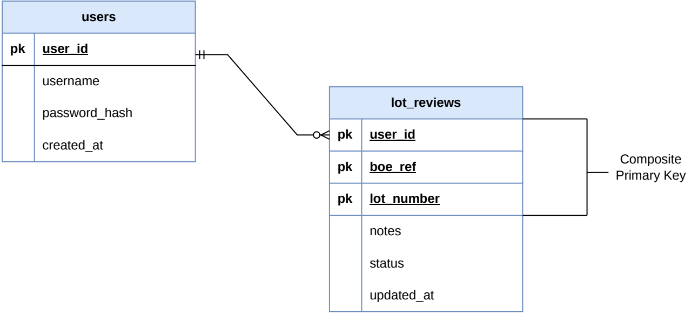

# Subastas Analytics: from BOE auctions to a decision-making dashboard

[](https://github.com/MiguelDonado/subastas_analytics/actions/workflows/tests.yml)

A personal project to keep learning data engineering, especially OLAP data
modelling, build my first GenAI application, and practice the skill of building
useful things.

The problem here was my own. A few years ago I bought some rustic properties at
the public auctions of the Spanish State, and evaluating each one took me a lot
of time. Not only because I had to jump by hand between the BOE, the Catastro,
map viewers and other websites, but also because the process wasn't organized:
I often had to check the same land several times, because I didn't remember
some of its characteristics.

It was a good fit for this kind of project:

- **A clear use for GenAI:** the auctions are published as free text. Claude
  reads each announcement and extracts the lots, their prices and their
  catastral references.
- **A clear data engineering pipeline:** a weekly Airflow DAG that collects the
  announcements, enriches them with Catastro data and loads them into
  PostgreSQL.
- **A good case for OLAP data modelling:** the data goes from raw text to a
  model built for analysis, which the app reads.
- **A clear final use:** a web app where I explore the lots on a map and in a table, and decide
  which ones are worth investing in.

**Live app:** <https://01a1e61c-7dc8-69e3-b535-b360f28ed430.share.connect.posit.cloud/>
(the first visit after a while takes a few seconds, while the app and the
database wake up)

To try it, log in with the test user: username `test`, password `test`. Its notes are shared
with everyone who uses it.

---

## 🎥 Video Tutorials

> [!IMPORTANT]
> **Watch these videos before using the application.**
>
> 1. ▶️ **[Project walkthrough](TODO)**: the project and how the code works
> 2. ▶️ **[How to use the dashboard](TODO)**: filters, map, table and notes

---

## Table of Contents

- [Subastas Analytics: from BOE auctions to a decision-making dashboard](#subastas-analytics-from-boe-auctions-to-a-decision-making-dashboard)
  - [🎥 Video Tutorials](#-video-tutorials)
  - [Table of Contents](#table-of-contents)
  - [Demo](#demo)
  - [Background](#background)
  - [Objectives](#objectives)
  - [Tech stack](#tech-stack)
  - [Workflow](#workflow)
    - [1. Data engineering](#1-data-engineering)
    - [2. Web application](#2-web-application)
    - [3. Analytics: how I use it to decide](#3-analytics-how-i-use-it-to-decide)
    - [Database: OLAP and OLTP](#database-olap-and-oltp)
  - [Deployment](#deployment)
  - [CI/CD](#cicd)
  - [Getting Started](#getting-started)
    - [Prerequisites](#prerequisites)
    - [Setup](#setup)
  - [Future improvements](#future-improvements)
  - [License](#license)

---

## Demo

A short walkthrough:


---

## Background

The Spanish State sells through public auctions the properties it owns but
doesn't need, either for public use or for a public service, and that aren't
worth managing itself. Many of them are rustic land. The State can own them for
different reasons: expropriations, inheritances, or land left over after a land
consolidation (concentración parcelaria). Each auction is published in two places:

- **Hacienda's website**, [Listado de subastas y concursos](https://www.hacienda.gob.es/es-ES/Areas%20Tematicas/Patrimonio%20del%20Estado/Gestion%20Patrimonial%20del%20Estado/Paginas/Subastas/ListadoSubastasConcursos.aspx),
  publishes the pliego de condiciones of each auction: a PDF with the complete,
  detailed information. Example: [pliego of an auction in Soria](assets/example_pliego_soria.pdf).
- **The [BOE](https://www.boe.es)** (Boletín Oficial del Estado) publishes a
  daily summary, which the [BOE Open Data API](https://www.boe.es/datosabiertos/)
  serves. The pipeline reads these summaries to find the auction announcements
  of the Delegaciones de Economía y Hacienda. An announcement has less
  information than the pliego, but it contains everything the app needs. Example: [announcement of the same auction](https://www.boe.es/diario_boe/txt.php?id=BOE-B-2026-34259).

I like nature and see rustic land as a good investment, so once I start working
again I'd like to buy more if I see a good opportunity.

The problem was the time each one took. For every announcement I had to read
the text, find the catastral references, look each parcel up in the Catastro
and other map viewers, check where it is, look at the aerial photo, and then
decide. And since I wasn't saving any of it, it quickly became a mess: to
compare the properties I hadn't discarded and pick the most interesting ones, I
often had to go through the whole process again for each of them.

This application does most of that work for me. It leads to better decisions
by making the whole process much faster, keeping everything organized, and
avoiding redundancy: I no longer have to collect the data of the same land
several times. It's also useful for other people around me who are interested
in these auctions, like my father and my friend Silvia, so each of them has
their own user.

---

## Objectives

1. **Practice building useful things.** With AI, only executing technical tasks
   has less and less value. What matters is being curious, asking questions,
   finding new problems and designing the architecture of their solution. I also
   want to start a company one day, and small projects like this one, about
   topics I care about, are the stepping stones towards it.
2. **Practice data engineering:** a real Airflow pipeline, tests and CI, and
   databases, with a focus on OLAP data modelling: a medallion architecture
   (bronze, silver and gold), where gold is a dimensional model following a star schema.
3. **Help me invest in rustic properties:** find the interesting lots quickly
   and keep a record of my decisions.
4. **Build a GenAI application:** practice seeing where AI is a good fit, and
   use it where it really adds value. Here it reads free-text announcements and
   turns them into structured data.

---

## Tech stack

| Area | Tools |
|---|---|
| **GenAI** | Claude API, with structured outputs (Pydantic) |
| **Data engineering** | Python, uv, Airflow (Astro CLI), systemd timers, Healthchecks.io |
| **Data sources** | BOE Open Data API, Goolzoom (Catastro data) |
| **Database** | PostgreSQL: medallion architecture, star schema |
| **Web app** | R, Shiny, Leaflet (geospatial visualization), login with `shinymanager` |
| **Cloud** | Neon (database), Posit Connect Cloud (app) |
| **Testing and CI/CD** | pytest, testcontainers, shinytest2 (end-to-end tests of the app), GitHub Actions |

---

## Workflow

The project has three parts:

<p align="center">
  
</p>

### 1. Data engineering

An Airflow DAG runs every Monday and follows a medallion architecture:

| Layer | What happens |
|---|---|
| **Bronze** | Downloads the BOE summaries of the past 7 days. Titles that pass the regexes are possible auctions, and Claude confirms which ones really are. Their raw text is stored |
| **Silver** | Takes every bronze announcement that isn't in silver yet. Claude reads the raw text and extracts the lots, starting prices and catastral references into a fixed schema. Goolzoom adds the Catastro data of each reference: coordinates, use, class, surface and crop. Stored in 3NF, and announcements that fail go to their own table for review, so they aren't sent to Claude again |
| **Gold** | Rebuilt from silver on every run as a star schema, plus the view the app reads |

Bronze only holds the BOE announcements, in a single table, because the BOE is
the only source. Claude and Goolzoom are called with data already in bronze, so
their results are enrichment and go straight to silver
([why](docs/2.data_modelling.md#only-the-boes-content-is-stored-in-bronze)).

When an auction has a second or third round, it's a new announcement in the
BOE, so it's loaded like any other. The rounds of the same property are linked
through their catastral references.

Alerts follow the rule "no news is bad news": every successful run pings
[healthchecks.io](https://healthchecks.io), and if the ping doesn't arrive, it
emails me. A failed task also pings it right away. So it emails me when:

- A task still fails after its retries, or an announcement fails in silver. The email is sent right away.
- No auction titles show up in the BOE for 2 weeks in a row, which suggests the regexes no longer match. The email is sent right away.
- The pipeline doesn't run at all, for example because the laptop was off. The email comes on Tuesday at 10:00.

The email only says that something went wrong. The cause is in the Airflow
task logs:

- **Bronze:** how many titles passed the regexes and how many Claude confirmed.
  Each title Claude rejected gets a `NOT AN AUCTION` line. A title that mentions
  Hacienda and subasta but doesn't pass the regexes gets a `NEAR MISS` line.
- **Silver:** every announcement ends with one line that includes its BOE
  reference: `LOADED`, `FAILED` (a problem with the announcement, with the
  reason) or `STOPPED` (Claude or Goolzoom failed). Each lot or catastral
  reference that was left out gets a `REJECTED` line that says why.

Details in [`docs/1.scheduling_monitoring.md`](docs/1.scheduling_monitoring.md).

### 2. Web application

A Shiny app with a login. On the left, filters (province, municipio, class,
use, maximum price, minimum surface, status). On the right, a map with the
parcels on top and a table with one row per lot below. Clicking a row zooms the
map to its parcels, and clicking a parcel selects its row in the table.

Each parcel is a marker on the map. Its popup shows the main data of that
parcel: catastral reference, use, class, surface and crop, plus a link to open
it in Google Maps.

Each user can mark a lot as **Interesado** or **Descartado** and write a note
on it, for example "visited, it is very steep".

### 3. Analytics: how I use it to decide

Right now the app doesn't draw conclusions on its own: it has no summaries,
trends or models. The analysis is done by me while using it, and the app gives
me the data in the right shape to do it quickly:

1. Every week, filter by **Sin revisar** to see only the new lots.
2. Filter by what I'm looking for: area, class, price, surface.
3. Compare the lots in the table, for example by **€/m²**.
4. For the ones that look interesting, check the parcels on the aerial photo
   and the Catastro layer: access, surroundings, crops, rivers.
5. Mark each lot as Interesado or Descartado, with a note.
6. Only for the few marked as Interesado, read the conditions on Hacienda's
   website and decide whether to bid.

### Database: OLAP and OLTP

The PostgreSQL database has two parts, for two kinds of data:

| Part | Schemas | What it holds | Who writes it | Who reads it |
|---|---|---|---|---|
| **OLAP** | `bronze`, `silver`, `gold` | Auctions, lots and parcels from the BOE | The pipeline, once a week | The app, to filter and compare lots on the map and in the table |
| **OLTP** | `app` | Users, and their notes and status on each lot | The app, one note at a time | The app, to show each user their notes |

All the app's writes and reads of notes go to `app`. A note has to show up as
soon as it's saved, and gold is only rebuilt on Mondays, so the app can't read
the notes from gold.

The notes aren't copied into bronze, silver and gold, because only the app
reads them and nothing analyzes them. To analyze them, for example to count
discarded lots per province, bronze would copy `app.lot_reviews` once a week
and the notes would go through the layers like the BOE data. The app would
still write and show the notes from `app`, and only the reports would read them
from gold.

<details>
<summary><b>OLAP: silver data model (3NF)</b></summary>


</details>

<details>
<summary><b>OLAP: gold data model (star schema)</b></summary>


</details>

<details>
<summary><b>OLTP: users and notes data model</b></summary>


</details>

More details in [`docs/2.data_modelling.md`](docs/2.data_modelling.md#oltp-and-olap).

---

## Deployment

The app is online, so it can be opened from any browser, even when my laptop
is off. Only Airflow stays on the laptop:

```
Laptop (Airflow, weekly)  ──writes──▶  Neon (PostgreSQL)  ◀──reads──  Posit Connect Cloud (Shiny)  ◀──  browser
```

- **[Neon](https://neon.tech)** hosts the PostgreSQL database. It has a free
  plan and goes to sleep when nothing is connected.
- **[Posit Connect Cloud](https://connect.posit.cloud)** hosts the Shiny app. It
  builds it from this GitHub repo. There's no container of ours: Posit installs
  the exact R and package versions listed in `dashboard/manifest.json` on its
  own servers and runs the app there. The database credentials are set as
  secrets in Connect Cloud, never in the repo.
- **Two database users:** Airflow connects as the owner of the database, and
  the app as `subastas_app`, which can only read gold and write the notes.

Details in [`docs/4.deployment.md`](docs/4.deployment.md).

---

## CI/CD

| Stage | What happens | How |
|---|---|---|
| **Continuous Integration** | Every pull request to `main`, and every push to `main`, runs the unit tests, integration tests, DAG tests and the app's end-to-end tests | GitHub Actions, [`tests.yml`](.github/workflows/tests.yml) |
| **Protected `main`** | `main` only changes through pull requests, and a pull request can only merge when all three checks pass | GitHub ruleset |
| **Continuous Deployment** | Merging into `main` republishes the live app, with no manual step | Posit Connect Cloud, watching the repo |

The tests never call the real APIs, so CI needs no API keys and costs nothing.

The app also has end-to-end tests, written with shinytest2. They open the real
app in Chrome and use it like a person would: they search, click rows and save
notes, and check that the table, the map and the notes react. Each run builds
its own Postgres from the repo: the tables from the gold and app SQL files, and
the rows from a fixed set of 210 lots. That's what lets them run in CI too,
since they don't depend on any database outside the repo.

Details in [`docs/5.ci_cd.md`](docs/5.ci_cd.md) and
[`docs/7.testing.md`](docs/7.testing.md).

---

## Getting Started

### Prerequisites

- **[Docker](https://docs.docker.com/get-docker/)**: Airflow runs in containers.
- **[Astro CLI](https://www.astronomer.io/docs/astro/cli/install-cli)**: runs
  Airflow locally. No Astronomer account is needed.
- **[uv](https://docs.astral.sh/uv/)**: to install the Python dependencies and
  run the tests.
- **R** with **renv**: only to run the shiny app on your own machine.
- **Accounts and API keys:**
  - [Anthropic](https://console.anthropic.com): Claude API key (paid per use).
  - [Goolzoom](https://www.goolzoom.com): API key to add the Catastro data to
    each catastral reference (free).
  - [Neon](https://neon.tech): the database (free plan).
  - [Healthchecks.io](https://healthchecks.io): a check for the alerts (free
    plan).
  - [Posit Connect Cloud](https://connect.posit.cloud): only to publish the shiny app
    online (free plan).

### Setup

1. **Clone the repository:**

   ```bash
   git clone https://github.com/MiguelDonado/subastas_analytics.git
   cd subastas_analytics
   ```

2. **Create a Neon project** in AWS US East 2 (Ohio), the region where Posit
   Connect Cloud runs the app, with a database called `subastas`. Copy its
   connection string from the **Connect** button.

3. **Create the env file** and fill in the connection string and the API keys:

   ```bash
   cp .env.example .env
   ```

4. **Start Airflow:**

   ```bash
   astro dev start
   ```

   The Airflow UI is at <http://localhost:8081>. The DAG starts unpaused and, because of `catchup=True`, runs once
   for every Monday since its `start_date`. Each run sends the new
   announcements to Claude, so it costs API credits.

5. **Create the app schema and the database user `subastas_app`**, once, connected to Neon with the owner database user:

   ```bash
   psql "<neon-connection-string>" -f include/sql/create_app.sql
   psql "<neon-connection-string>" -f include/sql/create_app_role.sql
   ```

   Then set the password of the database user `subastas_app` with SQL, as
   explained in
   [`docs/4.deployment.md`](docs/4.deployment.md#setting-the-password-of-subastas_app).
   The Neon console can't do it, because the role has no password yet.

   Last, add the people who will log in to the app to `app.users`. Each one
   gets their own notes. How to do it is in
   [`docs/11.reviews.md`](docs/11.reviews.md).

6. **Run the app locally.** Copy `dashboard/.Renviron.example` to
   `dashboard/.Renviron` and fill in two values: the Neon host (the part
   between `@` and `/` in the connection string) and the password of the
   database user `subastas_app`. Then open `dashboard/dashboard.Rproj` in
   RStudio, or start R from the `dashboard` folder, and run:

   ```r
   renv::restore()
   shiny::runApp()
   ```

   To publish it online instead, follow
   [`docs/4.deployment.md`](docs/4.deployment.md).

7. **Optional: schedule it.** To start and stop Airflow every Monday with a
   systemd timer, follow [`systemd/README.md`](systemd/README.md).

To run the tests:

```bash
uv sync
uv run pytest                    # unit and integration tests
astro dev pytest tests/dags      # DAG tests
```

The app's end-to-end tests run from R, in the `dashboard` folder, with
`shinytest2::test_app()`. They need Docker and Google Chrome: they start their
own database (details in
[`docs/7.testing.md`](docs/7.testing.md#app-end-to-end-e2e-tests)).

## Future improvements

Right now the project has no data analysis part of its own. These additions
would give it one:

- **Compare each lot with a reference price:** the starting price against the
  Catastro's reference value (valor de referencia) of its parcels, which covers
  all rustic land, forest included.
- **Learn from my reviews:** compare the lots marked Interesado with the
  Descartado ones, and later a model that flags the lots I would probably like.

Other ideas: an open-source LLM to cut costs, and a faster
app on Posit Connect Cloud.

---

## License

This project is licensed under the [MIT License](LICENSE).