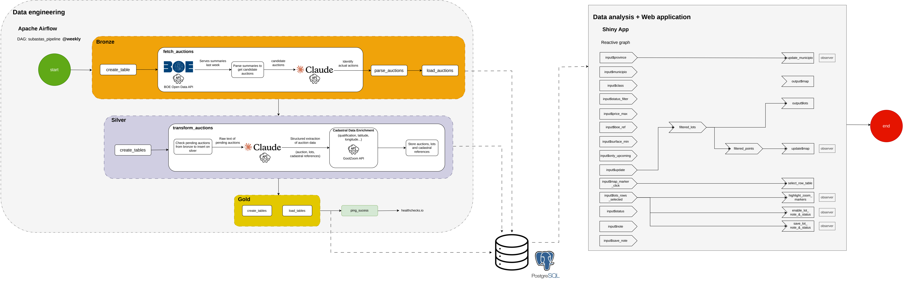

# Subastas Analytics: from BOE auctions to a decision-making dashboard

[](https://github.com/MiguelDonado/subastas_analytics/actions/workflows/tests.yml)

A personal project to keep learning data engineering, especially OLAP data
modelling, build my first GenAI application, and practice the skill of building
useful things.

The problem here was my own. A few years ago I bought some rustic properties at
the public auctions of the Spanish State, and evaluating each one took me a lot
of time. Not only because I had to jump by hand between the BOE, the Catastro,
map viewers and other websites, but also because the process wasn't organized:
I often had to check the same land several times, because I didn't remember
some of its characteristics.

It was a good fit for this kind of project:

- **A clear use for GenAI:** the auctions are published as free text. Claude
  reads each announcement and extracts the lots, their prices and their
  catastral references.
- **A clear data engineering pipeline:** a weekly Airflow DAG that collects the
  announcements, enriches them with Catastro data and loads them into
  PostgreSQL.
- **A good case for OLAP data modelling:** the data goes from raw text to a
  model built for analysis, which the app reads.
- **A clear final use:** a web app where I explore the lots on a map and in a table, and decide
  which ones are worth investing in.

**Live app:** <https://01a1e61c-7dc8-69e3-b535-b360f28ed430.share.connect.posit.cloud/>
(the first visit after a while takes a few seconds, while the app and the
database wake up)

To try it, log in with the test user: username `test`, password `test`. Its notes are shared
with everyone who uses it.

---

## 🎥 Video Tutorials

> [!IMPORTANT]
> **Watch these videos before using the application.**
>
> 1. ▶️ **[Project walkthrough](TODO)**: the project and how the code works
> 2. ▶️ **[How to use the dashboard](TODO)**: filters, map, table and notes

---

## Table of Contents

- [Subastas Analytics: from BOE auctions to a decision-making dashboard](#subastas-analytics-from-boe-auctions-to-a-decision-making-dashboard)
  - [🎥 Video Tutorials](#-video-tutorials)
  - [Table of Contents](#table-of-contents)
  - [Demo](#demo)
  - [Background](#background)
  - [Objectives](#objectives)
  - [Tech stack](#tech-stack)
  - [Workflow](#workflow)
    - [1. Data engineering](#1-data-engineering)
    - [2. Web application](#2-web-application)
    - [3. Analytics: how I use it to decide](#3-analytics-how-i-use-it-to-decide)
  - [Deployment](#deployment)
  - [CI/CD](#cicd)
  - [Getting Started](#getting-started)
    - [Prerequisites](#prerequisites)
    - [Setup](#setup)
  - [Built with Claude](#built-with-claude)
  - [Future improvements](#future-improvements)
  - [License](#license)

---

## Demo

A short walkthrough:


---

## Background

The Spanish State sells through public auctions the properties it owns but
doesn't need, either for public use or for a public service, and that aren't
worth managing itself. Many of them are rustic land. The State can own them for
different reasons: expropriations, inheritances, or land left over after a land
consolidation (concentración parcelaria). Each auction is published in two places:

- **Hacienda's website**, [Listado de subastas y concursos](https://www.hacienda.gob.es/es-ES/Areas%20Tematicas/Patrimonio%20del%20Estado/Gestion%20Patrimonial%20del%20Estado/Paginas/Subastas/ListadoSubastasConcursos.aspx),
  publishes the pliego de condiciones of each auction: a PDF with the complete,
  detailed information. Example: [pliego of an auction in Soria](assets/example_pliego_soria.pdf).
- **The [BOE](https://www.boe.es)** (Boletín Oficial del Estado) publishes a
  daily summary, which the [BOE Open Data API](https://www.boe.es/datosabiertos/)
  serves. The pipeline reads these summaries to find the auction announcements
  of the Delegaciones de Economía y Hacienda. An announcement has less
  information than the pliego, but it contains everything the app needs. Example: [announcement of the same auction](https://www.boe.es/diario_boe/txt.php?id=BOE-B-2026-34259).

I like nature and see rustic land as a good investment, so once I start working
again I'd like to buy more if I see a good opportunity.

The problem was the time each one took. For every announcement I had to read
the text, find the catastral references, look each parcel up in the Catastro
and other map viewers, check where it is, look at the aerial photo, and then
decide. And since I wasn't saving any of it, it quickly became a mess: to
compare the properties I hadn't discarded and pick the most interesting ones, I
often had to go through the whole process again for each of them.

This application does most of that work for me. It leads to better decisions
by making the whole process much faster, keeping everything organized, and
avoiding redundancy: I no longer have to collect the data of the same land
several times. It's also useful for other people around me who are interested
in these auctions, like my father and my friend Silvia, so each of them has
their own user.

---

## Objectives

1. **Practice building useful things.** With AI, only executing technical tasks
   has less and less value. What matters is being curious, asking questions,
   finding new problems and designing the architecture of their solution. I also
   want to start a company one day, and small projects like this one, about
   topics I care about, are the stepping stones towards it.
2. **Practice data engineering:** a real Airflow pipeline, tests and CI, and
   databases, with a focus on OLAP data modelling: a medallion architecture
   (bronze, silver and gold), where gold is a dimensional model following a star schema.
3. **Help me invest in rustic properties:** find the interesting lots quickly
   and keep a record of my decisions.
4. **Build a GenAI application:** practice seeing where AI is a good fit, and
   use it where it really adds value. Here it reads free-text announcements and
   turns them into structured data.

---

## Tech stack

| Area | Tools |
|---|---|
| **GenAI** | Claude API, with structured outputs (Pydantic) |
| **Data engineering** | Python, uv, Airflow (Astro CLI), systemd timers, Healthchecks.io |
| **Data sources** | BOE Open Data API, Goolzoom (Catastro data) |
| **Database** | PostgreSQL: medallion architecture, star schema |
| **Web app** | R, Shiny, Leaflet (geospatial visualization), login with `shinymanager` |
| **Cloud** | Neon (database), Posit Connect Cloud (app) |
| **Testing and CI/CD** | pytest, testcontainers, GitHub Actions |

---

## Workflow

The project has three parts:

<p align="center">
  
</p>

### 1. Data engineering

An Airflow DAG runs every Monday and follows a medallion architecture:

| Layer | What happens |
|---|---|
| **Bronze** | Downloads the BOE summaries of the past 7 days, keeps the Hacienda auction announcements, and stores their raw text |
| **Silver** | For each new announcement, Claude extracts the lots, starting prices and catastral references. Goolzoom adds the Catastro data of each reference: coordinates, use, class, surface and crop. Stored in 3NF, and announcements that fail go to their own table for review |
| **Gold** | Rebuilt from silver on every run as a star schema, plus the view the app reads |

When an auction has a second or third round, it's a new announcement in the
BOE, so it's loaded like any other. The rounds of the same property are linked
through their catastral references.

### 2. Web application

A Shiny app with a login. On the left, filters (province, municipio, class,
use, maximum price, minimum surface, status). On the right, a map with the
parcels on top and a table with one row per lot below. Clicking a row zooms the
map to its parcels, and clicking a parcel selects its row in the table.

Each user can mark a lot as **Interesado** or **Descartado** and write a note
on it, for example "visited, the house needs a new roof".

### 3. Analytics: how I use it to decide

Right now the app doesn't draw conclusions on its own: it has no summaries,
trends or models. The analysis is done by me while using it, and the app gives
me the data in the right shape to do it quickly:

1. Every week, filter by **Sin revisar** to see only the new lots.
2. Filter by what I'm looking for: area, class, price, surface.
3. Compare the lots in the table, for example by **€/m²**.
4. For the ones that look interesting, check the parcels on the aerial photo
   and the Catastro layer: access, surroundings, crops, rivers.
5. Mark each lot as Interesado or Descartado, with a note.
6. Only for the few marked as Interesado, read the conditions on Hacienda's
   website and decide whether to bid.

What used to take me hours of jumping between websites now takes minutes.

---

## Deployment

The app is online, so it can be opened from any browser, even when my laptop
is off. Only Airflow stays on the laptop:

```
Laptop (Airflow, weekly)  ──writes──▶  Neon (PostgreSQL)  ◀──reads──  Posit Connect Cloud (Shiny)  ◀──  browser
```

- **[Neon](https://neon.tech)** hosts the PostgreSQL database. It has a free
  plan and goes to sleep when nothing is connected.
- **[Posit Connect Cloud](https://connect.posit.cloud)** hosts the Shiny app. It
  builds it from this GitHub repo, using `dashboard/manifest.json` to install
  the exact R and package versions. The database credentials are set as
  secrets in Connect Cloud, never in the repo.
- **Two database users:** Airflow connects as the owner of the database, and
  the app as `subastas_app`, which can only read gold and write the notes.

Details in [`docs/4.deployment.md`](docs/4.deployment.md).

---

## CI/CD

| Stage | What happens | How |
|---|---|---|
| **Continuous Integration** | Every pull request to `main`, and every push to `main`, runs the unit and integration tests (against a throwaway Postgres) and the DAG tests | GitHub Actions, [`tests.yml`](.github/workflows/tests.yml) |
| **Protected `main`** | `main` only changes through pull requests, and a pull request can only merge when both checks pass | GitHub ruleset |
| **Continuous Deployment** | Merging into `main` republishes the live app, with no manual step | Posit Connect Cloud, watching the repo |

The tests never call the real APIs, so CI needs no API keys and costs nothing.

Details in [`docs/5.ci_cd.md`](docs/5.ci_cd.md) and
[`docs/7.testing.md`](docs/7.testing.md).

---

## Getting Started

### Prerequisites

- **[Docker](https://docs.docker.com/get-docker/)**: Airflow runs in containers.
- **[Astro CLI](https://www.astronomer.io/docs/astro/cli/install-cli)**: runs
  Airflow locally. No Astronomer account is needed.
- **[uv](https://docs.astral.sh/uv/)**: to install the Python dependencies and
  run the tests.
- **R** with **renv**: only to run the app on your own machine.
- **Accounts and API keys:**
  - [Anthropic](https://console.anthropic.com): Claude API key (paid per use).
  - [Goolzoom](https://www.goolzoom.com): API key for the Catastro data.
  - [Neon](https://neon.tech): the database (free plan).
  - [Healthchecks.io](https://healthchecks.io): a check for the alerts (free
    plan).
  - [Posit Connect Cloud](https://connect.posit.cloud): only to publish the app
    online (free plan).

### Setup

1. **Clone the repository:**

   ```bash
   git clone https://github.com/MiguelDonado/subastas_analytics.git
   cd subastas_analytics
   ```

2. **Create a Neon project** with a database called `subastas`, and copy its
   connection string from the **Connect** button.

3. **Create the env file** and fill in the connection string and the API keys:

   ```bash
   cp .env.example .env
   ```

4. **Start Airflow:**

   ```bash
   astro dev start
   ```

   The Airflow UI is at <http://localhost:8081> (8080 is left free for other
   projects). The DAG starts unpaused and, because of `catchup=True`, runs once
   for every Monday since its `start_date`. Each run sends the new
   announcements to Claude, so it costs API credits.

5. **Create the app's tables and user**, once, connected to Neon as the owner:

   ```bash
   psql "<neon-connection-string>" -f include/sql/create_app.sql
   psql "<neon-connection-string>" -f include/sql/create_app_role.sql
   ```

   Then set the password of `subastas_app` in the Neon console (Roles &
   Databases → `subastas_app` → Reset password), and add users to `app.users`
   as explained in [`docs/11.reviews.md`](docs/11.reviews.md).

6. **Run the app.** Copy `dashboard/.Renviron.example` to `dashboard/.Renviron`
   and fill in the Neon host and the `subastas_app` password. Then, in R, from
   the `dashboard` folder:

   ```r
   renv::restore()
   shiny::runApp()
   ```

   To publish it online instead, follow
   [`docs/4.deployment.md`](docs/4.deployment.md).

7. **Optional: schedule it.** To start and stop Airflow every Monday with a
   systemd timer, follow [`systemd/README.md`](systemd/README.md).

To run the tests:

```bash
uv sync
uv run pytest                    # unit and integration tests
astro dev pytest tests/dags      # DAG tests
```

---

## Built with Claude

- **Tests (`tests/`):** written with Claude. Only the unit tests
  (`tests/unit`) were reviewed.
- **Failure modes ([`docs/6.failure_modes.md`](docs/6.failure_modes.md)):**
  built with the help of Claude, then carefully reviewed and modified.

---

## Future improvements

Right now the project has no data analysis part of its own. These additions
would give it one:

- **Compare each lot with a reference price:** the starting price against the
  Catastro's reference value (valor de referencia) of its parcels, which covers
  all rustic land, forest included.
- **Compare with similar lots:** €/m² against lots with the same province, use
  and crop type, once location is included too (for example distance to the
  nearest village).
- **Where and when:** number of lots and €/m² by province and month, to see
  where the supply is and which areas are cheaper.
- **Learn from my reviews:** compare the lots marked Interesado with the
  Descartado ones, and later a model that flags the lots I would probably like.
- **Final price:** if the BOE publishes the winning bid, store it and predict
  the final price of new lots.

Other ideas: end-to-end tests, an open-source LLM to cut costs, and a faster
app on Posit Connect Cloud.

---

## License

This project is licensed under the [MIT License](LICENSE).